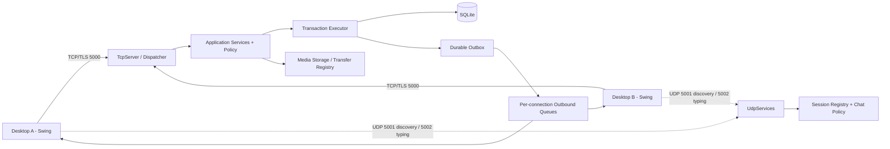

# 03 — Kiến trúc, concurrency và vận hành mục tiêu

Thiết kế v2 chưa triển khai. Giữ một server Java 17, TCP/TLS, UDP và SQLite; không cần microservices/REST/web để đáp ứng đề tài Desktop.

## 1. Sơ đồ thành phần



Discovery không xác thực; typing cần session TCP đã auth và HMAC. Client không kết nối trực tiếp với nhau. Server operator có dashboard/no-ui; admin nghiệp vụ qua client đăng nhập role ADMIN.

## 2. Phân lớp và cấu trúc dự kiến

```text
common/src/main/java/com/p2p/common/
  protocol/       envelope, frame, command, error, UDP DTO
  dto/            auth, profile, friendship, post, chat, media...
  validation/     limits và kiểm input dùng chung
server/src/main/java/com/p2p/server/
  bootstrap/      wiring, lifecycle, config
  network/tcp/    acceptor, reader, writer, dispatcher
  network/udp/    discovery, registration, typing, HMAC
  session/        authenticated identity, heartbeat, registry
  application/    AuthService, ProfileService, FriendshipService
                  PostService, ChatService, MediaService
                  NotificationService, ModerationService
  policy/         PostPolicy, ChatPolicy, ProfilePolicy, AdminPolicy
  repository/     SQL từng aggregate, không gửi socket
  database/       migrations, TransactionExecutor, query executor
  storage/        quota, paths, checksum, recovery, cleanup
  events/         outbox dispatcher, invalidation, audience policy
  admin/          bootstrap tool, audit
client/src/main/java/com/p2p/client/
  network/        TLS, request futures, timeout, reader/writer, UDP
  service/        auth, feed, chat, profile, media, notification
  state/          current user, connection, paged cache, cursors
  controller/     screen actions và orchestration
  ui/             views/panels/dialogs + theme
  storage/        temp download, cache, drafts nếu thêm P2
```

Đây là cây mục tiêu; chưa cần tạo hàng loạt class rỗng. Dùng package hiện tại và refactor từng lát cắt. Common chứa DTO/codec, không chứa JDBC, Swing hoặc authority nghiệp vụ. Shared validation giúp UI báo nhanh; server vẫn validate độc lập.

Luồng request: frame decode → envelope/version/schema validation → session/auth → handler → service policy/transaction → DTO response. SQLException/IOException không lộ stack/path vào response. Transport không thực hiện INSERT trực tiếp.

## 3. Mô hình thread và hàng đợi

### Server

- Acceptor chỉ accept, áp permit mọi socket kể cả chưa auth và khởi tạo lifecycle. Semaphore 50 connection mặc định; không đếm riêng user online.
- Java 17 blocking I/O có reader và writer theo connection với pool/resource giới hạn rõ. 50 socket tương ứng tối đa khoảng 100 thread I/O; không dùng unbounded cached pool. Tách executor I/O khỏi nghiệp vụ để thread chờ reader không làm writer starvation.
- Mỗi connection có một writer duy nhất. Codec stateless; bỏ `static synchronized` toàn JVM. Reader giữ thứ tự request trên cùng connection; mutation DB được xếp vào writer executor trung tâm.
- Outbound queue giới hạn **256 frame và 8 MiB**, không chỉ số item. Control/chat ưu tiên cao, file chunk thấp. Khi quá ngưỡng: bỏ typing/invalidation dư có thể refetch; không bỏ ACK/durable chat âm thầm; đóng connection chậm với lỗi/backpressure và cho resync.
- Chunk ≤48 KiB, cửa sổ 4 chunk/transfer; tối đa 2 transfer/user để bulk không chiếm queue. Nếu max queue/timeout chạm thì pause/cancel, không cấp phát vô hạn.
- Scheduler riêng cho heartbeat, session/transfer expiry và cleanup. Không chạy checksum/decode ảnh trong EDT/dashboard hay giữ transaction dài.
- Business CPU/hash executor hữu hạn 2–4 worker theo máy; login rate-limit trước hash. Storage I/O executor riêng giới hạn để file lớn không nghẽn auth.

### Client

- TLS connect/read/write, upload/download/hash/thumbnail chạy nền. Không ghi socket, đọc disk hay query mạng trên Swing EDT.
- Reader dispatch response tới CompletableFuture theo requestId; event tới service/state, rồi mới invokeLater cập nhật view.
- File chunk tới TransferService trực tiếp, không đưa Base64 của mọi chunk vào event queue EDT. Progress throttle khoảng 100–200 ms; chỉ UI model nhỏ được post lên EDT.
- Client outbound queue hữu hạn tương tự server; khi mất kết nối vô hiệu hóa mutation, giữ pending ID trong RAM để tra lại sau login. Không tự gửi lại mutation với ID mới.
- Reconnect tạo transport mới; không reuse executor đã shutdown trong ChatClient v1.

## 4. SQLite và transaction

Chọn một **DbWriteExecutor** tuần tự hóa transaction mutation; một write connection chỉ thread đó sử dụng. Read-only queries dùng tối đa 2 connection riêng, mỗi connection không dùng đồng thời bởi nhiều thread. Không chắp transaction bằng các method synchronized trên cùng connection từ nhiều worker.

- Mỗi connection: FK ON, WAL, busy_timeout 5s; `synchronous=FULL` cho dữ liệu cần bền vững, kiểm hiệu năng thực tế.
- Write transaction ngắn: validate quyền có thể thay đổi + mutation + outbox + idempotency. Hash password, checksum, đọc file thực hiện trước/ngoài transaction.
- `BEGIN IMMEDIATE` cho writer hoặc abstraction JDBC tương đương đã test; rollback mọi exception. Không giữ transaction trong khi chờ socket/UI/file.
- Read policy + fetch trong cùng read transaction/snapshot khi cần đồng nhất; tại dispatch/download còn phải kiểm quyền hiện tại.
- UNIQUE/CHECK/FK là lớp bảo vệ sau service. Index theo truy vấn cụ thể; không làm mọi index tùy tiện.

SQLite phù hợp một server đồ án. Chỉ đánh giá PostgreSQL P2 khi có số đo bottleneck hoặc yêu cầu nhiều server; việc đổi DB không tự sửa policy/race.

## 5. Sự kiện, ACK và đồng bộ lại

Mutation commit gồm business row + outbox row. Dispatcher đọc outbox sau commit, enqueue cho session còn quyền; khi không có session vẫn giữ dữ liệu message/notification để client lấy sau. Outbox là bảo vệ crash giữa commit và push, không cam kết exactly-once delivery.

- Event có eventId, aggregateId, revision/seq. Client dedup theo ID/revision.
- Các event post/profile dùng invalidation, client fetch lại bằng quyền hiện tại. Không lưu text riêng tư dài trong outbox rồi phát khi quyền đã đổi.
- Outbox audience lấy từ ID và policy tại dispatch. Event của direct message đã commit trước block vẫn hợp lệ lịch sử; group kiểm active membership/visibleFromSeq.
- Sau login: lấy profile, relationships, conversation list + latestSeq/unread, notification cursor; với conversation đang mở lấy message afterSeq; refresh feed. `STATE_SYNC` trả metadata giới hạn và phân trang, không dump cả DB.
- Không cần journal mọi realtime event vĩnh viễn; sync từ DB là nguồn sự thật. Outbox đã xử lý dọn sau 7 ngày; client quá lâu không dùng event cursor như bảo đảm đầy đủ.

## 6. Lifecycle, timeout, shutdown

- Connect/TLS deadline 5 giây mỗi bước, HELLO/auth deadline 15 giây. Response thường 10 giây; tác vụ finalize file có deadline riêng tối đa 60 giây theo kích thước.
- TCP PING 15 giây; phản hồi `kind=RESPONSE,type=PING` cùng requestId/nonce. Sau 45 giây không có frame hợp lệ/heartbeat response thì close. KeepAlive OS hỗ trợ, không thay heartbeat ứng dụng.
- Ghi timestamp hoạt động theo monotonic clock cho timeout. UTC chỉ dùng dữ liệu/event; tránh đổi giờ máy làm phiên sống mãi.
- Shutdown idempotent, kể cả lỗi bind hoặc NEW chưa start: ngừng accept/UDP → báo stopping nếu còn thời gian → revoke session và đóng toàn bộ socket → dừng transfer, persist offset/cleanup → await executors deadline → checkpoint/close DB. Đóng socket mới giải phóng blocking read.
- Không update DB sau close; mỗi resource owned và close đúng một lần. Start fail phải close DB/pool đã mở.

## 7. TLS, session và bảo mật thực dụng

- SSLSocket/SSLServerSocket, TLS 1.2+ (ưu tiên 1.3). Demo LAN dùng certificate tự ký và truststore/pinned fingerprint được cung cấp ngoài discovery; không trust-all, không tự chấp nhận cert bất kỳ.
- Password hash PBKDF2WithHmacSHA256, salt SecureRandom ít nhất 16 byte, output 32 byte, mặc định 600.000 iteration; lưu algorithm/iterations/salt/hash, benchmark login để điều chỉnh có căn cứ. Constant-time compare; rehash khi nâng tham số.
- Client request userId chỉ target; actor từ session. Mỗi request check ACTIVE/auth_version. UDP key per-session cấp qua TLS, revoke theo logout/lock.
- Typed DTO, Jackson không bật polymorphic default typing; giới hạn payload, collection, string, decode depth. Prepared statements; sort field whitelist; LIKE xử lý wildcard có chủ đích.
- Rate-limit: login 5 lần/phút/IP+username, friend request 20/giờ/user, post 10/phút, message 60/phút, comment 30/phút, report 10/giờ. Các ngưỡng có config và test; trả RATE_LIMITED + retryAfterMs.
- Không log password/hash/session key/UDP secret, raw message riêng hoặc full auth JSON. Log requestId, actorId, type, duration, outcome, byte count; dữ liệu nhạy cảm mask.
- Kho media ngoài classpath, không mở folder public. Đường dẫn do UUID server tạo; resolve-normalize containment và không đi qua symlink/reparse point ngoài root.

## 8. TCP/UDP và cấu hình

| Kênh | Mặc định | Nội dung |
|---|---|---|
| TCP/TLS | 5000 | HELLO/auth, mọi dữ liệu bền vững, history, file chunks |
| UDP discovery | 5001 | DISCOVER/OFFER nhỏ, chưa auth, LAN |
| UDP realtime | 5002 | REGISTER/typing signed, theo session TCP |

Ví dụ cấu hình **mục tiêu**, chưa được ServerConfig hiện tại hỗ trợ:

```properties
server.bind=0.0.0.0
server.tcp.port=5000
server.udp.discovery.port=5001
server.udp.realtime.port=5002
server.max.connections=50
server.handshake.timeout.ms=15000
server.heartbeat.interval.ms=15000
server.heartbeat.timeout.ms=45000
database.path=data/social-network.db
storage.root=data/media
media.image.max.bytes=5242880
media.chat.max.bytes=26214400
media.user.quota.bytes=209715200
tls.enabled=true
tls.key.store=config/server.p12
```

Secret keystore/password lấy env/file local không Git. Fail-fast port 1–65535, limit dương, timeout/quota hợp lý. Đường dẫn relative resolve từ app root/config base được định nghĩa thống nhất, không tùy terminal cwd. Dashboard hiển thị path đã resolve và TCP/UDP status.

## 9. Storage consistency, log và backup

DB và filesystem không có chung atomic transaction. Media ghi temp → verify → trạng thái VERIFYING có metadata/hash/path nội bộ → atomic move → update READY; crash ở mọi điểm được recovery job đối chiếu. Có file đúng hash ở final và VERIFYING thì hoàn tất READY; thiếu/mismatch thì FAILED/quarantine, không expose.

ATTACHED chỉ sau business transaction tham chiếu; file bị mồ côi dọn theo retention, không xóa file còn reference. Startup recovery chạy trước nhận upload/download mới. Delete vật lý dùng UUID storage key, không filename client, kiểm containment như upload.

Log rotate (ví dụ 5×10 MiB), audit moderation append-only theo API; số liệu dashboard: all sockets/auth sessions/queue bytes/transfer bytes/DB latency/outbox backlog. Backup gồm DB nhất quán + media inventory/objects, restore vào data root riêng để xác minh trước thay server đang chạy; chi tiết ở [08](08-testing-release.md).
