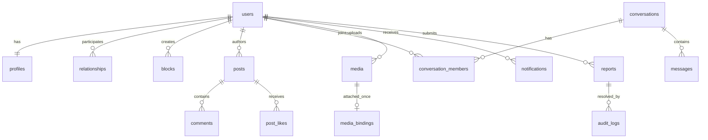

# 04 — Mô hình dữ liệu, ràng buộc và migration

Schema v2 mục tiêu; đây chưa phải migration có thể chạy ngay. Các DDL mẫu minh họa các ràng buộc khó; cần viết migration đầy đủ và kiểm thử trước khi đưa vào app.

## 1. Quy ước

- SQLite INTEGER PRIMARY KEY cho ID server; UUID TEXT cho clientMessageId/idempotencyKey/transferId/sessionId/eventId. ID integer đưa qua JSON như integer trong Java long, không cast int.
- Thời gian `*_at` INTEGER epoch milliseconds UTC; sequence/version INTEGER. Không trộn TEXT Instant cũ với kiểu mới trong cùng column.
- Status/enum TEXT + CHECK; boolean INTEGER CHECK IN (0,1); dùng FK ON mọi connection.
- Soft delete cho post/comment; không xóa user thật trong phạm vi bắt buộc. SUSPENDED khác DELETED.
- Bí mật hash/key không nằm DTO public. Session/UDP key sống trong RAM; DB không lưu password hoặc session plaintext.

## 2. Tổng quan entity



ERD rút gọn; một relationship có hai FK user, một direct conversation có cặp unique, media_bindings có FK typed tới profile/post/message.

## 3. Danh sách bảng và invariant

| Bảng | Cột chính cần có | Ràng buộc/quy tắc |
|---|---|---|
| schema_migrations | version PK, checksum, applied_at | Migration đã áp dụng không sửa lịch sử |
| users | id, username, username_key, password_hash, salt, hash_algorithm, hash_iterations, role, status, auth_version, relationships_version, created_at, last_login_at | username_key UNIQUE, role USER/ADMIN, status ACTIVE/SUSPENDED; hash không rỗng; relationships_version tăng khi friend/block ảnh hưởng user |
| profiles | user_id PK/FK, display_name, bio, version, updated_at | Profile tạo cùng user; avatar qua media_bindings |
| relationships | id, low_user_id, high_user_id, requester_id, addressee_id, status, version, requested_at, resolved_at | low<high; hướng nằm trong cặp; một active pair |
| blocks | blocker_id, blocked_id, created_at | PK pair có hướng, blocker != blocked |
| posts | id, author_id, content, visibility, status, version, created_at, updated_at, deleted_at | Visibility PUBLIC/FRIENDS/ONLY_ME; status ACTIVE/DELETED/HIDDEN |
| comments | id, post_id, author_id, content, status, created_at, deleted_at | Không parent_comment_id; không rỗng |
| post_likes | post_id, user_id, created_at | PK(post_id,user_id), không cần like_id |
| conversations | id, kind, direct_low_id, direct_high_id, title, owner_id, status, last_seq, created_at, last_activity_at, version | DIRECT/GROUP, direct pair unique, group owner required; activity cập nhật khi message commit |
| conversation_members | id, conversation_id, user_id, role, joined_at, left_at, visible_from_seq, last_delivered_seq, last_read_seq | Một period active/user/conversation, read<=delivered<=last seq theo service |
| group_invites | id, conversation_id, inviter_id, invitee_id, status, expires_at, created_at | Một pending invite/user/group; ACCEPT không thể sau expire |
| messages | id, conversation_id, conversation_seq, sender_id, client_message_id, payload_hash, kind, content, created_at | Unique conversation+seq và sender+client_message_id; TEXT không attachment, FILE có attachment và có thể kèm text |
| media | id (UUID), owner_id, purpose, original_name, mime_type, declared_size, actual_size, sha256, storage_key, state, created_at, expires_at | UUID path do server cấp; READY/ATTACHED phải có size/hash đúng |
| media_bindings | media_id PK, avatar_user_id, post_id, message_id, slot, bound_at | Đúng một typed target, tối đa 1 lần attach/media |
| file_transfers | id UUID, media_id, user_id, direction, state, acknowledged_offset, failure_code, expires_at, updated_at | Upload/download FSM; offset 0..size; owner/member ACL; session binding RAM được cấp lại khi resume |
| notifications | id, recipient_id, actor_id, type, source_key, post_id, comment_id, relation_id, conversation_id, group_invite_id, latest_seq, is_read, created_at, updated_at | Unique recipient+source_key; FK nullable đúng loại theo service |
| reports | id, reporter_id, target_type, target_id, reason, description, snapshot_json, status, version, assigned_admin_id, resolution, created_at, resolved_at | Chỉ USER/POST/COMMENT; partial unique report active; version tăng claim/resolve |
| audit_logs | id, admin_id, report_id, action, target_type, target_id, reason, before_json, after_json, created_at | Không có API update/delete; không log password/chat |
| idempotency_records | actor_id, operation, key, payload_hash, result_json, resource_id, created_at, expires_at | PK actor+operation+key, cùng key khác hash lỗi |
| outbox_events | event_id PK, type, aggregate_type, aggregate_id, aggregate_version, audience_json, created_at, dispatched_at, attempts | Không chứa auth secret hoặc full private post text |

`target_id` report/audit là tham chiếu nhiều loại nên không có một FK duy nhất; validate target_type + existence/permission trong transaction. Snapshot giúp xử lý target đã soft delete. Notification typed FK dễ kiểm hơn field resource chung, có CHECK phù hợp khi viết migration.

## 4. DDL mẫu cho invariant quan trọng

### Relationship không trùng và không accept request cũ

```sql
CREATE TABLE relationships (
  id INTEGER PRIMARY KEY,
  low_user_id INTEGER NOT NULL REFERENCES users(id),
  high_user_id INTEGER NOT NULL REFERENCES users(id),
  requester_id INTEGER NOT NULL REFERENCES users(id),
  addressee_id INTEGER NOT NULL REFERENCES users(id),
  status TEXT NOT NULL CHECK(status IN
    ('PENDING','ACCEPTED','REJECTED','CANCELLED','REMOVED')),
  version INTEGER NOT NULL DEFAULT 1 CHECK(version >= 1),
  requested_at INTEGER NOT NULL,
  resolved_at INTEGER,
  CHECK(low_user_id < high_user_id),
  CHECK((requester_id=low_user_id AND addressee_id=high_user_id)
     OR (requester_id=high_user_id AND addressee_id=low_user_id))
);
CREATE UNIQUE INDEX uq_relation_active_pair
  ON relationships(low_user_id, high_user_id)
  WHERE status IN ('PENDING','ACCEPTED');
CREATE INDEX ix_relation_incoming
  ON relationships(addressee_id, status, requested_at DESC, id DESC);
```

Lần mời lại sau terminal tạo row/id mới. ACCEPT dùng `UPDATE ... WHERE id=? AND status='PENDING' AND addressee_id=? AND version=?`; nếu row count 0 thì không tự chuyển friendship. Block kết thúc active row trong cùng transaction.

### Direct conversation và message dedup

```sql
CREATE UNIQUE INDEX uq_direct_pair
  ON conversations(direct_low_id, direct_high_id)
  WHERE kind='DIRECT';
CREATE UNIQUE INDEX uq_active_member
  ON conversation_members(conversation_id, user_id)
  WHERE left_at IS NULL;
CREATE UNIQUE INDEX uq_message_sequence
  ON messages(conversation_id, conversation_seq);
CREATE UNIQUE INDEX uq_sender_client_message
  ON messages(sender_id, client_message_id);
```

Conversation CHECK: DIRECT thì low<high, owner/title null; GROUP thì direct ids null, title/owner non-null. Hai active member DIRECT tạo cùng transaction và không leave; GROUP owner phải là một active member role OWNER. Partial UNIQUE `(conversation_id) WHERE role='OWNER' AND left_at IS NULL` bảo vệ tối đa một owner; “ít nhất một” do transaction/service đảm bảo.

Tăng `conversations.last_seq` trong write transaction, insert message với seq mới. Read/delivered cursor dùng seq cùng conversation, không global messageId. Member active period của group lưu visible_from_seq để kiểm lịch sử/attachment.

### Attachment một mục tiêu và FK rõ ràng

```sql
CREATE TABLE media_bindings (
  media_id TEXT PRIMARY KEY REFERENCES media(id),
  avatar_user_id INTEGER REFERENCES profiles(user_id),
  post_id INTEGER REFERENCES posts(id),
  message_id INTEGER REFERENCES messages(id),
  slot INTEGER NOT NULL DEFAULT 0 CHECK(slot BETWEEN 0 AND 3),
  bound_at INTEGER NOT NULL,
  CHECK((avatar_user_id IS NOT NULL) + (post_id IS NOT NULL)
      + (message_id IS NOT NULL) = 1)
);
CREATE UNIQUE INDEX uq_avatar_binding
  ON media_bindings(avatar_user_id) WHERE avatar_user_id IS NOT NULL;
CREATE UNIQUE INDEX uq_message_attachment
  ON media_bindings(message_id) WHERE message_id IS NOT NULL;
CREATE UNIQUE INDEX uq_post_image_slot
  ON media_bindings(post_id, slot) WHERE post_id IS NOT NULL;
```

Service kiểm media purpose/owner/READY, post tối đa 4 ảnh, message FILE có một binding trong **cùng transaction**; DB CHECK không tự kiểm existence row con. Post text rỗng được phép khi transaction tạo ảnh đi kèm; không cho repository public bypass invariant. Avatar replace unbind media cũ và chuyển RETIRED, bind media mới và update profile version atomic. MediaId đã attach không được dùng lại cho resource khác; RETIRED không trở lại READY. Post/comment soft delete giữ reference trong retention, GC sau đó unbind/chuyển RETIRED trước xóa vật lý.

## 5. Index theo truy vấn

- posts `(status,created_at DESC,id DESC)` và `(author_id,status,created_at DESC,id DESC)`; privacy/friend/block filter trong SQL trước LIMIT.
- blocks PK(blocker,blocked) và index `(blocked_id,blocker_id)` để kiểm hai hướng.
- relationships index theo cả low/high + status; active unique pair dùng truy vấn bạn bè.
- comments `(post_id,status,created_at,id)`; post_likes PK và `(user_id,post_id)` nếu query activity.
- messages unique conversation+seq phục vụ history hai chiều; members `(user_id,left_at,conversation_id)` phục vụ conversation list.
- notifications `(recipient_id,is_read,created_at DESC,id DESC)` và source unique; conversation list index theo member và `(last_activity_at DESC,id DESC)`.
- media `(owner_id,state)` và `(state,expires_at)`; transfers `(state,expires_at)`.
- outbox `(dispatched_at,created_at)`; reports `(status,created_at)`; usernames unique + profile search limit.

Đo EXPLAIN QUERY PLAN trên dữ liệu seed. Không tải toàn bộ row rồi lọc privacy/phan trang Java. COUNT cũng phải filter theo policy, kể cả actor đã block.

## 6. Transaction bắt buộc

| Operation | Những thay đổi phải commit/rollback cùng nhau |
|---|---|
| REGISTER | users + profiles, UNIQUE username |
| FRIEND_ACCEPT | Verify pending/actor/block/ACTIVE → ACCEPTED → notifications/outbox/idempotency |
| BLOCK | Insert block → terminal pending/friend → invalidation/idempotency |
| POST_CREATE | Post → bindings READY→ATTACHED → outbox/idempotency |
| POST_EDIT/PRIVACY | Check author/version → content/visibility/version → invalidation |
| LIKE_SET | Policy → insert/delete unique → dedup notification/outbox |
| COMMENT_CREATE | Policy → comment → notification/outbox/idempotency |
| MESSAGE_SEND | Policy → seq increment → message + binding → notification/outbox + dedup |
| GROUP_ACCEPT/KICK/OWNER | Invitation/membership/role/period + seq bounds → event |
| MODERATE | Verify admin → target status/auth_version → report → audit + event |
| PASSWORD_CHANGE | Verify current hash → new hash/auth_version → session invalidation |

Nếu notification nhiều người không thể tạo nhanh trong transaction, ghi durable job/outbox với recipient policy, thực thi idempotent sau. Không fire-and-forget RAM rồi tuyên bố notification bền vững.

## 7. Idempotency và retention

- Mutation thông thường giữ idempotency record 7 ngày, result DTO tối thiểu không chứa secret. Retry cùng actor/op/key/hash trả result sau khi xác thực actor và kiểm quyền kết quả; tài nguyên đã mất quyền thì trả trạng thái kết quả không kèm private text.
- MESSAGE_SEND giữ dedup `(sender_id,client_message_id)` suốt thời gian giữ message. Có payload hash riêng trên message hoặc lookup đối chiếu nội dung/media; không dựa chỉ record 7 ngày.
- Auth/register không cache password hoặc auth response chứa UDP key. Register retry xử lý UNIQUE username và trạng thái rõ; login có state session riêng.
- Server không cam kết dedup key đã hết retention với mutation thông thường; client không tự retry sau 7 ngày, refresh state trước khi quyết định.
- READY orphan/UPLOADING expire sau 24h; temp transfer terminal dọn, metadata FAILED giữ phục vụ chẩn đoán ngắn hạn. Outbox handled dọn 7 ngày; audit/report không tự dọn trong đồ án.
- Post/comment soft-delete giữ metadata; file không còn reference dọn sau 7 ngày bằng GC. Direct history giữ; không có API hard delete user.

## 8. Migration từ MiniChat

**Phương án khuyến nghị cho cuối kỳ: DB v2 mới** `data/social-network.db`, DB cũ `p2p-chat.db` giữ nguyên để demo bài tập. User v1 có hash rỗng và tên Unicode không theo quy tắc username mới; không tự coi người nhập cùng tên là chủ tài khoản cũ.

Nếu cần nhập dữ liệu cũ: công cụ offline có mapping admin xác nhận oldUserId → newUserId sau user đăng ký; username conflict được xử lý; message type/room được chuyển có audit. Không copy hash rỗng rồi cho login. Tệp relay không lưu server thì không thể phục hồi từ metadata shared_files.

Quy trình migration v2:

1. Backup trước nâng schema; không sửa database đang dùng bằng tay.
2. Đọc schema_migrations/checksum; từ chối DB có version cao hơn app hoặc checksum migration cũ đổi.
3. Áp từng migration trong transaction; version chỉ ghi sau thành công. Tạo FK/index/cột theo thứ tự đã kiểm thử.
4. Run foreign_key_check, invariant query và media recovery; lỗi thì không nhận request nghiệp vụ.
5. Test nâng từ mỗi version được hỗ trợ và fresh install, không chỉ `CREATE TABLE IF NOT EXISTS`.

SQLite migration phức tạp có thể cần tạo bảng mới/copy/rename trong transaction với FK handling được test. Không tự rollback binary về schema cũ; khôi phục backup hoặc forward-fix đã kiểm tra.

## 9. Dữ liệu demo

Seed giả lập 6 user (một admin), pending/accepted/block, bài PUBLIC/FRIENDS/ONLY_ME, likes/comments, direct/group, tin offline và ảnh/file nhỏ có hash thật. Seed theo service/invariant, password mẫu chỉ trong dữ liệu demo được ghi rõ, không dùng credential thật. Bộ tải có 10.000 post, 50.000 message, media bounded để đo index/heap; không dùng chung DB học tập cá nhân.
