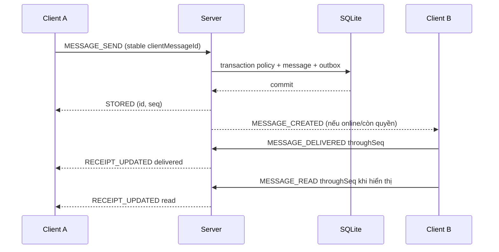

# 05 — Hợp đồng giao thức TCP/TLS và UDP phiên bản 2

Giao thức v2 đã có runtime `SocialServer`, transport `SocialClient` và giao diện `SocialWindow`. MiniChat v1 được giữ riêng trong các class cũ; entry point/shaded JAR mặc định chạy v2. Client/server v2 phải nâng cùng nhau; envelope có protocolVersion sai nhận VERSION_UNSUPPORTED rồi đóng kết nối. Tình trạng kiểm thử và giới hạn triển khai nằm tại [implementation-status](implementation-status.md).

## 1. TCP framing và envelope

TLS chạy trên TCP 5000; bên trong TLS giữ frame `[4-byte big-endian unsigned length][UTF-8 JSON]`. Java đọc int thì reject `length <= 0` hoặc `>1.048.576` trước cấp buffer. JSON thuần, không Java ObjectInputStream. EOF trước header là disconnect; EOF giữa header/payload là truncated frame. Malformed/oversize frame log code và close connection, không cố resync stream đã sai boundary.

Request mẫu:

```json
{
  "protocolVersion": 2,
  "kind": "REQUEST",
  "type": "MESSAGE_SEND",
  "requestId": "uuid-attempt",
  "idempotencyKey": "uuid-business-operation",
  "payload": {
    "conversationId": 17,
    "clientMessageId": "uuid-stable-message",
    "content": "Chào bạn",
    "mediaId": null
  }
}
```

Response cùng type/requestId:

```json
{
  "protocolVersion": 2,
  "kind": "RESPONSE",
  "type": "MESSAGE_SEND",
  "requestId": "uuid-attempt",
  "ok": true,
  "serverTime": 1791331200000,
  "payload": {"messageId": 812, "conversationSeq": 41, "status": "STORED"}
}
```

Error:

```json
{
  "protocolVersion": 2,
  "kind": "RESPONSE",
  "type": "POST_UPDATE",
  "requestId": "uuid-attempt",
  "ok": false,
  "error": {"code": "VERSION_CONFLICT", "message": "Bài viết đã thay đổi", "retryable": false},
  "payload": {"currentVersion": 4}
}
```

Event không hoàn tất pending request:

```json
{
  "protocolVersion": 2,
  "kind": "EVENT",
  "type": "POST_INVALIDATED",
  "eventId": "uuid-event",
  "serverTime": 1791331200000,
  "payload": {"postId": 90, "version": 4}
}
```

type là command/event string whitelist. Runtime hiện dùng WireMessage bean và payload/result map, kiểm whitelist field và validation theo từng command ở server; chưa tách class DTO riêng cho mọi type. Reject field không được phép trong payload mutation, nhất là actorId/role/storagePath. Map không được dùng để bypass schema hay lấy actor từ client. Max collection, content và Base64 length kiểm trước decode. Unknown type trả UNSUPPORTED_OPERATION nếu frame/schema còn hợp lệ.

## 2. Session và request semantics

1. TLS handshake với truststore/pin hợp lệ.
2. HELLO `{supportedVersions:[2], clientVersion}` → `{selectedVersion:2, capabilities, limits, heartbeatIntervalMs, serverId, serverTime}`.
3. AUTH_REGISTER hoặc AUTH_LOGIN. Sau login trả `user` (DTO hồ sơ hiện tại), sessionId, UDP config/key. Session gắn socket, không gửi TCP bearer token mọi request.
4. Các request auth-only lấy actor từ connection; PING/LOGOUT vẫn có schema/check state.
5. AUTH_LOGOUT hoặc disconnect thu hồi session/UDP capability. TCP reconnect phải HELLO/login lại.

requestId UUID cho một attempt, chỉ correlation; idempotencyKey UUID ổn định cho một ý định mutation. Retry dùng requestId mới + key/clientMessageId cũ. Result idempotency được commit cùng mutation; cùng key khác payload trả IDEMPOTENCY_CONFLICT. Auth không cache password/UDP key qua cơ chế này. Query không cần key.

Client pending request có deadline 10s thường/60s finalize. Timeout = kết quả chưa biết; không tự tạo mutation mới. Retry chỉ lỗi retryable hoặc lỗi transport với cùng key. Event có thể đến trước response của cùng operation; client upsert theo resourceId/version, không append hai lần.

## 3. Catalog request mục tiêu

`*` là mutation cần idempotencyKey (ngoại trừ auth/session riêng). Kết quả dưới đây là DTO tối thiểu; không trả entity JDBC/raw DB.

| Nhóm/type | Input quan trọng | Result/kiểm quyền |
|---|---|---|
| HELLO | supportedVersions, clientVersion | Version/capabilities/limits; trước auth |
| AUTH_REGISTER | username, displayName, password | userId; UNIQUE username; không auto-login |
| AUTH_LOGIN | username, password | user summary, sessionId, UDP config; một active session |
| AUTH_LOGOUT | rỗng | ACK rồi revoke/close |
| AUTH_PASSWORD_CHANGE | currentPassword, newPassword | authVersion; revoke session sau ACK |
| PING | nonce | RESPONSE type PING cùng requestId/nonce, payload serverTime |
| PROFILE_GET | targetUserId | Profile theo block/status |
| PROFILE_UPDATE* | displayName, bio, expectedVersion | Profile/version của actor |
| AVATAR_SET* | mediaId, expectedVersion | Avatar binding của actor |
| USER_SEARCH | query, cursor, limit | User summary được phép thấy |
| RELATION_LIST | kind INCOMING/OUTGOING/FRIENDS, cursor, limit | Relations của actor; FRIENDS có online/asOf theo session |
| PRESENCE_GET | userIds tối đa 50 | Chỉ friend hiện tại/self; online/asOf snapshot |
| FRIEND_REQUEST* | targetUserId | relationId/status hoặc pending cũ |
| FRIEND_ACCEPT/REJECT/CANCEL* | relationId, expectedVersion | Status; hướng đúng |
| FRIEND_REMOVE* | relationId | REMOVED nếu actor thuộc cặp |
| BLOCK_SET* | targetUserId, blocked true/false | Trạng thái hướng của actor; không toggle |
| BLOCK_LIST | cursor, limit | User tối thiểu do actor block |
| POST_CREATE* | content, visibility, mediaIds[0..4] | postId/version, bind media READY |
| POST_GET | postId | Post detail + permitted counts |
| POST_UPDATE* | postId, content, visibility, expectedVersion | Version mới; bản bắt buộc không đổi ảnh sau create |
| POST_DELETE* | postId, expectedVersion | Soft-delete; author |
| FEED_GET | cursor, limit | Page policy trước LIMIT |
| PROFILE_POSTS_GET | authorId, cursor, limit | Timeline với policy |
| COMMENT_LIST | postId, cursor, limit | Page comment/tombstone |
| COMMENT_CREATE* | postId, content | commentId; policy + notification |
| COMMENT_DELETE* | commentId | Author comment/post; không edit |
| LIKE_SET* | postId, liked true/false | liked/count theo viewer |
| CONVERSATION_DIRECT_GET_OR_CREATE* | targetUserId | conversationId; friend/no block |
| CONVERSATION_LIST | cursor, limit | Title/member summary/latestSeq/unread |
| MESSAGE_SEND* | conversationId, clientMessageId, content, mediaId? | STORED + messageId/seq |
| MESSAGE_HISTORY | conversationId, beforeSeq? hoặc afterSeq?, limit | Page, latestSeq, membership bounds |
| MESSAGE_LOOKUP | clientMessageId | Tin của sender + kết quả đã commit hoặc NOT_FOUND |
| MESSAGE_DELIVERED* | conversationId, throughSeq | Cursor recipient tăng đơn điệu |
| MESSAGE_READ* | conversationId, throughSeq | Read/delivered tăng, seq trong quyền |
| GROUP_CREATE* | title | Group + actor OWNER |
| GROUP_INVITE* | conversationId, targetUserId | inviteId/expiry; owner/friend |
| GROUP_INVITE_LIST | cursor, limit | Lời mời actor hoặc owner được phép xem |
| GROUP_INVITE_ACCEPT/REJECT/CANCEL* | inviteId | Member period hoặc terminal |
| GROUP_MEMBERS_GET | conversationId, cursor, limit | Chỉ active member; không global roster |
| GROUP_RENAME/KICK/OWNER_TRANSFER* | conversationId, expectedVersion, title/userId | Owner-only, version và membership |
| GROUP_LEAVE/DISBAND* | conversationId, expectedVersion | Không bỏ group không owner |
| NOTIFICATION_LIST | cursor, limit, unreadOnly | DTO kiểm lại ACL |
| NOTIFICATION_READ* | notificationIds tối đa 50 | Chỉ của actor |
| NOTIFICATION_READ_THROUGH* | throughCursor | Không mark notification tương lai |
| NOTIFICATION_COUNT | rỗng | Unread authoritative |
| REPORT_CREATE* | targetType, targetId, reason, description | reportId; quyền xem target |
| ADMIN_REPORT_LIST/GET | filter, cursor/reportId | ADMIN, snapshot có audit |
| ADMIN_REPORT_CLAIM* | reportId, expectedVersion | IN_REVIEW + assignedAdmin |
| ADMIN_REPORT_RESOLVE* | reportId, action, reason, expectedVersion | Outcome + audit + target state |
| ADMIN_AUDIT_LIST/GET | cursor, limit, filter hoặc auditId | ADMIN-only, paged records không credential/chat text |
| ADMIN_USER_UNSUSPEND* | targetUserId, reason | Audit; ADMIN |
| ADMIN_GROUP_OWNER_TRANSFER/CLOSE* | conversationId, targetUserId?, expectedVersion, reason | Chỉ khi owner SUSPENDED; ADMIN, active member mới/audit |
| STATE_SYNC | conversationsCursor?, notificationsCursor?, limit | Hai page metadata độc lập + next cursor/hasMore từng loại, currentProfileVersion/relationshipsVersion |
| UDP_SESSION_REFRESH | rỗng | Key mới/expiry; chỉ TLS auth |

Media/transfer dùng catalog riêng ở phần 6. Runtime hiện có GROUP, admin, receipt và typing; HELLO khai báo capability tương ứng. Type ngoài catalog trả UNSUPPORTED_OPERATION. Việc một capability đã có source không thay thế bằng chứng kiểm thử nhiều máy hoặc checklist UI ở tài liệu [08](08-testing-release.md).

Tên capabilities thống nhất: `auth`, `profiles`, `relations`, `posts`, `directChat`, `media`, `notifications`, `udpDiscovery`, `groups`, `receipts`, `udpTyping`, `moderation`, `transferResume`. Mỗi field boolean, true chỉ khi client/server hỗ trợ luồng tương ứng; bản hoàn chỉnh P0/P1 phải true toàn bộ. Presence snapshot lấy sau login/relation refresh; event delta không thay snapshot ban đầu.

## 4. Pagination, version và error codes

- Limit default20/max50; history max100. Cursor opaque do server encode/ký, gồm actor/query/filter + anchor `(createdAt,id)` hoặc seq; không chấp nhận cursor của user/query khác.
- STATE_SYNC lần đầu bỏ cả cursor; mỗi collection có items/nextCursor/hasMore riêng, limit áp riêng từng collection. Có field includeConversations/includeNotifications để chỉ tải collection chưa xong. Sync lấy metadata mới hiện tại, không cam kết snapshot event lịch sử; đổi relationshipsVersion buộc refetch relation list theo trang, feed luôn refresh khi login.
- `items,nextCursor,hasMore` thống nhất. Offset pagination không dùng cho feed/history động. Post createdAt không đổi khi edit.
- Conversation list mới nhất theo `(lastActivityAt DESC,id DESC)`; active conversation có thể dịch trang khi tin mới đến, client upsert/dedup conversationId và refresh đầu trang. Không hứa snapshot cố định cho danh sách hoạt động; message history dùng seq để không mất message.
- POST_UPDATE/DELETE, profile, group owner/admin report nhận expectedVersion. VERSION_CONFLICT không auto-overwrite; user review state mới.
- Error code: INVALID_REQUEST, UNAUTHENTICATED, INVALID_CREDENTIALS, ACCOUNT_SUSPENDED, ALREADY_SIGNED_IN, USERNAME_TAKEN, NOT_FOUND, ACTION_FORBIDDEN, INVALID_STATE, INCOMING_REQUEST_EXISTS, ALREADY_FRIENDS, FRIENDSHIP_REQUIRED, VERSION_CONFLICT, IDEMPOTENCY_CONFLICT, RATE_LIMITED, QUOTA_EXCEEDED, FILE_TOO_LARGE, HASH_MISMATCH, OFFSET_MISMATCH, TRANSFER_EXPIRED, VERSION_UNSUPPORTED, UNSUPPORTED_OPERATION, SERVER_BUSY, INTERNAL_ERROR.
- RATE_LIMITED/SERVER_BUSY có retryAfterMs; OFFSET_MISMATCH có expectedOffset nhưng chỉ transfer owner được xem. Auth error không phân biệt username tồn tại. Không gửi SQL/path/stack trace.

## 5. Chat delivery và event catalog



Nếu B offline thì bỏ bước push; B lấy afterSeq sau login và ACK. Receipt tăng đơn điệu; sender không tự gọi nhận/đọc thay B. DIRECT hai member, GROUP cursor theo từng active member, summary `readByCount` không gọi “mọi người đã đọc” khi chỉ một người ACK.

Event: PROFILE_INVALIDATED, RELATION_CHANGED, POST_INVALIDATED, COMMENT_INVALIDATED, LIKE_INVALIDATED, MESSAGE_CREATED, RECEIPT_UPDATED, CONVERSATION_INVALIDATED, GROUP_INVITE_CHANGED, NOTIFICATION_CHANGED, PRESENCE_CHANGED, SESSION_REVOKED, SERVER_STOPPING. Các invalidation không mang private content; MESSAGE_CREATED có message DTO cho đúng member. Lỗi push không tạo lỗi gửi lại sender sau khi đã STORED.

## 6. Media upload/download trên cùng TCP

Không dùng FILE_OFFER/ACCEPT của v1 cho storage v2. Upload lên server trước; khi gửi message/file, recipient thấy card và tự chọn download. Sự chấp nhận download là UI local, không quyết định message có lưu hay không.

| Type | Input/result |
|---|---|
| MEDIA_THUMBNAIL_GET | mediaId → mediaId, mimeType="image/png", data Base64; cạnh dài nhất ≤256 px, không phóng to ảnh nhỏ; decoded PNG ≤300.000 byte; kiểm lại ACL trước trả, CHAT_FILE bị từ chối |
| MEDIA_UPLOAD_INIT* | purpose AVATAR/POST_IMAGE/CHAT_FILE, fileName, size, mimeType, sha256 → mediaId, transferId, chunkBytes, window, expiresAt |
| MEDIA_UPLOAD_CHUNK | transferId, offset, data Base64 → cumulative acknowledgedOffset |
| MEDIA_UPLOAD_STATUS | mediaId → state, transferId/offset nếu owner |
| MEDIA_UPLOAD_RESUME* | mediaId, size, sha256 → transferId mới gắn session hiện tại, offset server |
| MEDIA_UPLOAD_COMMIT* | transferId → READY hoặc VERIFYING + dùng STATUS poll có backoff |
| MEDIA_UPLOAD_CANCEL* | mediaId → CANCELLED, quota được giải phóng |
| MEDIA_DOWNLOAD_INIT* | mediaId, offset? → transferId, size, sha256, chunk/window theo ACL |
| MEDIA_DOWNLOAD_CHUNK event | transferId, offset, data → client write `.part` |
| MEDIA_DOWNLOAD_ACK | transferId, throughOffset → mở cửa sổ tiếp theo |
| MEDIA_DOWNLOAD_COMPLETE event | transferId, size/hash → client verify; chưa VERIFIED |
| MEDIA_DOWNLOAD_VERIFIED* | transferId, actualSize, actualSha256 → chỉ gửi khi verify pass; server đối chiếu metadata rồi terminal VERIFIED |
| MEDIA_DOWNLOAD_CANCEL* | transferId, reason USER_CANCEL/HASH_MISMATCH/IO_ERROR → stop/cleanup; terminal idempotent |
| MEDIA_DOWNLOAD_FAILED event | transferId, errorCode → terminal FAILED khi ACL thu hồi/expiry/storage lỗi, client dừng progress và cleanup |

Mỗi chunk decoded ≤49.152 byte, Base64 ≤65.536 ký tự, offset long không âm, window 4. Server registry cố định owner/metadata; không routing theo receiver/sender do client tự chỉ định. Offset expected chính xác; chunk cũ hoàn toàn trong vùng đã ACK được đối chiếu/hash hoặc trả expectedOffset, không ghi lặp. Chunk chồng chéo/nhảy offset/byte vượt size bị reject.

ACK upload cumulative chỉ sau flush/fsync checkpoint của cửa sổ và ghi offset metadata; crash không cho client tin byte chưa bền. Resume lấy min offset chắc chắn + kích thước temp thực tế theo recovery, không trust offset client. Commit verify toàn size/hash/magic ảnh, atomic move trong storage root và finalize DB như kiến trúc; chưa READY thì không attach/download như file hoàn chỉnh.

Transfer ownership bound user + active session; reconnect cấp transferId mới sau auth/STATUS/RESUME. `MEDIA_UPLOAD_STATUS` chỉ đọc metadata, không cấp quyền dùng transferId cũ. Retry `MEDIA_UPLOAD_INIT` với idempotencyKey đã commit có thể trả mediaId/transferId cũ và `requiresResume:true` khi transfer thuộc phiên trước. Đây là kết quả operation cũ, không phải giấy phép ghi chunk trong phiên mới: client gọi STATUS, đối chiếu size/hash, rồi `MEDIA_UPLOAD_RESUME` với key mới để nhận transferId gắn phiên hiện tại. Không retry INIT bằng key mới chỉ để tiếp tục cùng tệp. Download partial có thể resume khi metadata/hash khớp và quyền còn; server kiểm ACL trước mỗi window/chunk. Download chỉ VERIFIED mới báo file thành công, không báo chỉ vì gửi COMPLETE. File frame low-priority; control/chat vẫn được writer phục vụ giữa cửa sổ file.

Transfer idle deadline mặc định 30s không có chunk/ACK hợp lệ; kết thúc FAILED/EXPIRED với terminal event nếu connection còn. Upload lỗi có response error + trạng thái STATUS, download async lỗi luôn MEDIA_DOWNLOAD_FAILED. Client checksum fail gửi CANCEL(reason=HASH_MISMATCH), không gửi VERIFIED; giữ/quarantine hoặc xóa `.part` theo lựa chọn an toàn, không rename final. Disconnect xử lý bằng connection event và STATUS sau login, không chờ terminal event vô hạn. COMPLETE/FAILED/CANCEL lặp được dedup theo transferId; ACK sau terminal không mở lại transfer.

## 7. UDP discovery — port 5001

- Client bind DatagramSocket ephemeral, broadcast DISCOVER ở từng LAN interface hỗ trợ broadcast; có unicast probe nếu biết IP. Không broadcast Internet.
- Request `{protocolVersion:2,type:"DISCOVER",nonce:"random-128-bit",padding:"..."}` khoảng 256–512 byte. Server unicast OFFER về source endpoint, echo nonce, serverId/name, tcpPort, protocolVersion; **không** user list/token/password/internal path.
- Reply không lớn hơn request để giảm amplification; rate-limit theo source IP/global. Datagram max 1.200 byte. DISCOVER không hợp lệ không reply.
- Retry tối đa 3 lần khoảng 500ms + jitter, UI hết hạn danh sách sau vài giây. Không có UDP reliable-delivery handshake.
- OFFER là gợi ý địa chỉ chưa tin cậy. Client connect TLS, kiểm cert/pin và serverId. Không lấy trust fingerprint từ OFFER rồi auto-trust chính server quảng bá.
- Khi broadcast bị chặn vẫn nhập host/TCP port thủ công; discovery không là dependency của auth.

## 8. UDP registration/typing — port 5002, P1

Login TLS cấp `sessionId,keyEpoch,udpKey(32 byte random),keyExpiresAt,serverUdpPort`. Key tối đa 30 phút, refresh qua UDP_SESSION_REFRESH trước expiry; revoke khi logout/suspend/password change. Mỗi refresh tăng keyEpoch, vô hiệu key cũ ngay, clear endpoint, reset highestSeq/C2S/S2C counters cho epoch mới và yêu cầu UDP_REGISTER mới. Gói epoch cũ đang bay bị drop; không dùng userId/source IP đơn thuần làm xác thực.

Envelope UDP:

```json
{"sessionId":"uuid","keyEpoch":1,"body":"base64url-utf8-json","mac":"base64url-hmac-sha256"}
```

Decoded body C2S mẫu:

```json
{"v":2,"type":"TYPING","sessionId":"uuid","keyEpoch":1,"seq":23,"ts":1791331200000,"conversationId":17,"typing":true}
```

HMAC trên byte chính xác `UTF8("social-udp-v2:C2S:") || decodedBodyBytes`, key per-session/epoch. Server S2C dùng domain `social-udp-v2:S2C:` để chống reflection. Không parse rồi stringify để tính MAC; so MAC constant-time. Outer sessionId/keyEpoch phải bằng body và epoch active trên server. Validate max1200 trước decode, kiểm MAC rồi mới tin field; không log body/key.

1. C2S UDP_REGISTER signed seq mới. Server check session auth ACTIVE, key expiry, source IP bằng peer TCP trong phạm vi LAN, timestamp/seq; bind **source endpoint quan sát được**, không endpoint payload.
2. Server trả UDP_REGISTERED signed bằng key session, serverTime. Retry REGISTER dùng seq tăng, không reuse seq cũ. Rebind chỉ qua signed register; không để TYPING tự thay endpoint.
3. C2S TYPING tối đa 2 gói/giây/conversation, debounce khoảng 500ms; server kiểm quyền gửi direct/group theo policy và fan-out tới endpoint member còn quyền.
4. S2C TYPING chứa actorId do server cấp, conversationId, expiresAt; ký bằng **key riêng của từng recipient**, server seq riêng. Không forward MAC từ sender cho user khác.

C2S/S2C giữ highestSeq riêng per session; seq ≤highest bị drop (gói đảo thứ tự chấp nhận mất vì ephemeral). Timestamp lệch server quá 30s drop; client dùng serverTime từ TLS để ước lượng offset, không đòi đồng hồ máy tuyệt đối giống nhau. TTL typing 5s, tự hết nếu mất `typing=false`; không ghi DB, không retry từng typing, không ACK typing.

Nếu UDP registration/key hết hạn/mạng bị chặn: bỏ typing, chat TCP vẫn hoạt động. Presence chỉ TCP. UDP payload không có message text/file/avatar; HMAC xác thực nhưng không mã hóa, nên chỉ mang metadata tối thiểu. Không dùng UDP làm xác nhận message/file/notification.

## 9. Test hợp đồng

Frame split/coalesced/Unicode, length âm/oversize/truncated, unknown type, null field, forged actor, response/event interleaving, timeout/retry dedup; UDP packet giả MAC/replay/reflection/source thay/oversize/lost/reorder/key revoke; file offset/chunk quota/hash/resume. Các test và bằng chứng bắt buộc được liệt kê trong [08](08-testing-release.md).
